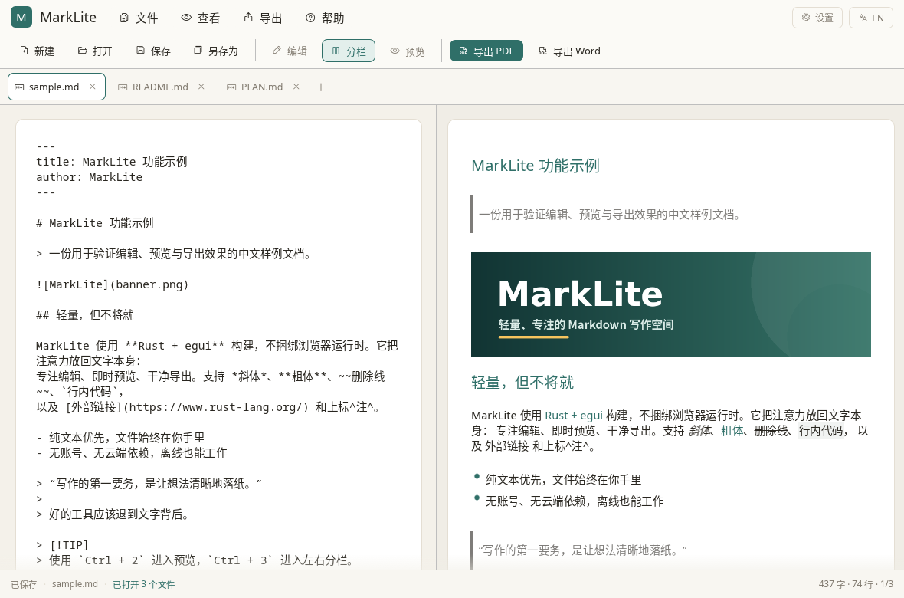
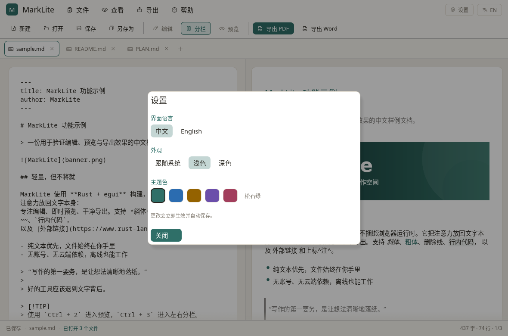
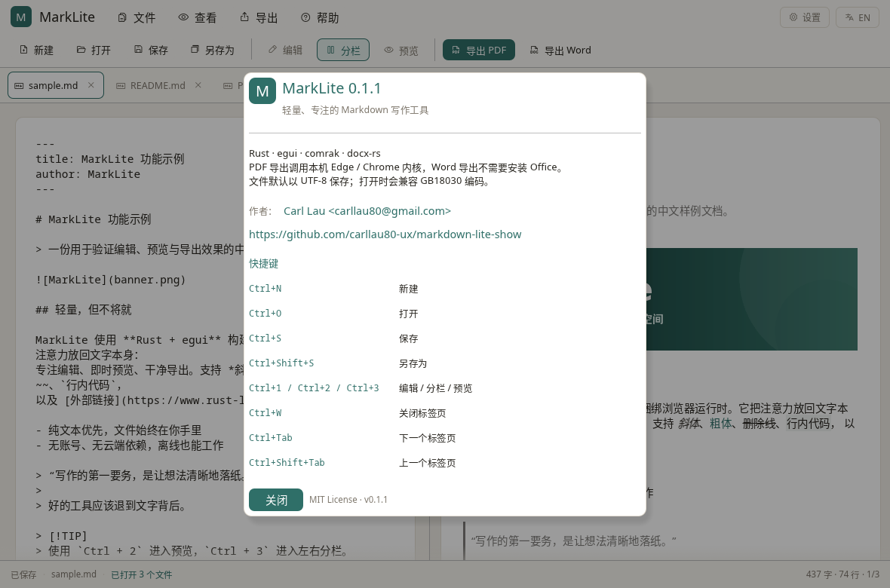

# MarkLite

一个用 Rust 编写的轻量级 Markdown 桌面工具：直接编辑 `.md` 文件，随时切换预览，并导出为 PDF / Word。

Windows 优先，代码同时按 Windows / macOS / Linux 跨平台方式组织。



## 下载

GitHub Releases 提供三个平台的构建：

- **Windows x64**：`MarkLite-0.1.1-windows-x64.zip`
- **Linux x86_64**：`MarkLite-0.1.1-linux-x86_64.tar.gz`
- **macOS Universal（Intel + Apple Silicon）**：`MarkLite-0.1.1-macos-universal.zip`

下载页：<https://github.com/carllau80-ux/markdown-lite-show/releases/latest>

页面中的 `SHA256SUMS.txt` 可用于校验。仓库内也保留了 Windows 便携版 `dist/mdlite.exe` 和 Linux 压缩包，方便直接获取。

## 功能

- **三种视图**：编辑、左右分栏、格式化预览（快捷键 `Ctrl+1/2/3`）；分栏左侧输入会实时联动右侧预览
- **多标签页**：同时打开多个 `.md`，标签切换、独立未保存状态、关闭确认；支持多选打开与多文件拖入
- **文件工作流**：打开、保存、另存为、拖放打开、未保存修改确认、关闭前确认、退出时全部保存
- **安全保存**：临时文件 + 原子替换；默认 UTF-8 写出
- **编码兼容**：打开时支持 UTF-8 与 GB18030/GBK 文本
- **PDF 导出**：A4 排版，支持标题、表格、代码块、引用、任务清单、提示框、脚注和本地图片
- **Word 导出**：生成标准 `.docx`，无需安装 Office；支持内嵌本地图片、表格、超链接、代码块、脚注
- **中英文界面**：右上角一键切换 `中文 / EN`，选择会自动保存
- **主题与主题色**：跟随系统 / 浅色 / 深色，5 套主题色；默认跟随系统
- **菜单与图标**：文件 / 查看 / 导出 / 帮助菜单及工具栏图标（Phosphor 图标字体）
- **macOS 原生集成**：系统菜单栏、原生关于面板与原生确认/错误提示框；界面优先使用系统 UI 字体和 macOS 风格配色
- **标签页关闭修复**：关闭按钮独立命中区域，避免与标签点击互相抢占
- **纯本地**：无账号、无云端依赖、无 Electron/WebView 前端；Markdown 文件始终由你保管

## 当前状态

`v0.1.1` 是当前版本：

| 平台 | 状态 |
| --- | --- |
| Windows | 已生成 x64 便携版并通过 PE 资源/导入检查；待 Windows 实机验收 |
| Linux | 已生成 x86_64 发布包，GUI 与主要工作流在开发机实测 |
| macOS | CI 构建 Universal `.app`（Intel + Apple Silicon）；待 macOS 实机验收 |

Windows 便携版位于 `dist\mdlite.exe` 与 `target\release\mdlite.exe`；Linux 包位于 `dist\MarkLite-0.1.1-linux-x86_64.tar.gz`。

三个平台的发布包由 GitHub Actions 在标签 `v*` 上自动构建：Windows / Linux / macOS Universal。macOS 与 Windows 包目前未签名，首次启动可能遇到系统安全提示。PDF 导出需要本机 Edge/Chrome/Chromium；Word 导出不需要 Office。

## Windows 构建

前置条件：

1. Rust 工具链（1.95 或更新）：<https://rustup.rs/>
2. “Microsoft C++ 生成工具”（安装 Rust MSVC 目标所需的链接器与 Windows SDK）

在项目目录执行：

```powershell
cargo build --release
```

产物：`target\release\mdlite.exe`。**只有执行 release 构建后才会生成这个路径**；仅运行 `cargo check` 或 `cargo build` 时不会生成 `target\release` 下的 exe。发布构建会隐藏 Windows 控制台窗口，并写入 exe 图标与版本信息。

也可以直接带文件启动：

```powershell
.\target\release\mdlite.exe path\to\note.md
```

## 界面与主题

点击右上角 **设置** 可调整：

- **界面语言**：中文 / English（默认中文，右上角的 `EN` / `中文` 也可快速切换）
- **外观**：跟随系统（默认）、浅色、深色
- **主题色**：松石绿、海盐蓝、琥珀、紫罗兰、玫瑰

语言、外观和主题色会自动保存到：

- Windows：`%APPDATA%\MarkLite\settings.json`
- macOS：`~/Library/Application Support/MarkLite/settings.json`
- Linux：`~/.config/MarkLite/settings.json`



## 快捷键

| 快捷键 | 功能 |
| --- | --- |
| `Ctrl+N` | 新建 |
| `Ctrl+O` | 打开 |
| `Ctrl+S` | 保存 |
| `Ctrl+Shift+S` | 另存为 Markdown |
| `Ctrl+1` | 编辑视图 |
| `Ctrl+2` | 左右分栏 |
| `Ctrl+3` | 预览视图 |
| `Ctrl+W` | 关闭当前标签页 |
| `Ctrl+Tab` | 下一个标签页 |
| `Ctrl+Shift+Tab` | 上一个标签页 |
| `Ctrl+Z / Ctrl+Y` | 撤销 / 重做（编辑器内置） |

macOS 上快捷键显示并使用 `Cmd`。

## 多标签页与分栏

- 点击 `打开` 可一次选择多个 Markdown 文件；也可以把多个文件拖入窗口。
- 已打开的文件重复打开时会直接切换到对应标签，不会创建副本。
- 每个标签独立保存内容、光标、滚动位置、撤销历史和未保存状态。
- 切换标签不会打断当前编辑，也不会强制保存。
- 关闭有未保存修改的标签会询问保存；关闭窗口时若有多个未保存标签，可选择“全部保存 / 全部不保存 / 取消”。
- 关闭最后一个标签会关闭窗口。
- 分栏模式的内容是**实时联动**的；编辑器与预览目前各自独立滚动，尚未实现滚动位置同步。

## macOS 与 Linux 构建

### Linux

```bash
sudo apt-get install libx11-dev libxkbcommon-dev libxi-dev libxrandr-dev \
  libxcursor-dev libxinerama-dev libgl1-mesa-dev libegl1-mesa-dev
cargo build --release
bash scripts/package-linux.sh
```

Linux 版使用 X11 / XWayland 和 OpenGL，文件对话框依赖 XDG Desktop Portal。压缩包内提供 `install.sh`，可安装到 `~/.local`。

### macOS

```bash
rustup target add aarch64-apple-darwin x86_64-apple-darwin
cargo build --release --target aarch64-apple-darwin
cargo build --release --target x86_64-apple-darwin
mkdir -p target/universal-apple-darwin/release
lipo -create \
  target/aarch64-apple-darwin/release/mdlite \
  target/x86_64-apple-darwin/release/mdlite \
  -output target/universal-apple-darwin/release/mdlite
bash scripts/package-macos.sh 0.1.1 target/universal-apple-darwin/release/mdlite
```

脚本会生成带图标和 `Info.plist` 的 `MarkLite.app`，并做 ad-hoc 签名。正式分发仍建议使用 Developer ID 签名与公证。

## 导出说明

### PDF

- 使用本机 **Edge / Chrome / Chromium** 的无头打印能力，A4 页面、打印样式已内置。
- 临时浏览器配置、临时 HTML 与临时 PDF 会在完成后清理。
- 找不到浏览器时，应用会给出明确提示，而不会静默失败。
- 本地图片按 Markdown 文件所在目录解析；远程图片是否可加载取决于浏览器与网络。

### Word

- 通过 [docx-rs](https://crates.io/crates/docx-rs) 直接生成 OOXML，不调用 Office 或外部转换器。
- 本地图片会嵌入文档，并按页面宽度自动缩放。
- 标题、段落格式、表格、引用、代码块、任务清单与脚注会保留为可编辑内容。
- 列表使用文本项目符号/序号 + 缩进，视觉上接近原生列表，但不是 Word 的自动编号字段（见路线图）。

## 已知限制

- Markdown 中的原始 HTML 默认不执行/不渲染（PDF 安全策略）；HTML 块会被忽略。
- 数学公式、Mermaid、图表暂未渲染。
- 预览和 Word 只加载本地图片；远程图片需要手动下载到本地。
- 超长文档的预览会整体布局，极大文件下滚动性能仍有优化空间。
- 预览中的任务列表会同时显示列表圆点和复选框（导出结果已处理干净）。
- 窗口内的工具栏按钮、Tab 和设置窗口仍由 egui 自绘（已按平台加载系统字体并适配圆角/配色）；macOS 的系统菜单、关于面板、确认与错误提示框使用原生组件。真正完全原生控件需要更换 UI 框架，本次未重写。
- 暂不恢复上次打开的标签页，也不支持标签拖拽排序；这些属于后续“会话恢复”范围。
- 超长文档的分栏预览仍是全量布局，尚未加入滚动位置同步或视口虚拟化。

## 技术栈

- UI：[egui / eframe](https://github.com/emilk/egui)（OpenGL，系统字体按需回退，中文可直接显示）
- Markdown：[comrak](https://crates.io/crates/comrak)（GFM 扩展）
- 预览：[egui_commonmark](https://crates.io/crates/egui_commonmark)
- Word：[docx-rs](https://crates.io/crates/docx-rs)
- PDF：自包含打印 HTML + 本机 Chromium 内核无头打印
- 文件对话框：[rfd](https://crates.io/crates/rfd)
- 原子保存：[atomicwrites](https://crates.io/crates/atomicwrites)
- 图标：[Phosphor Icons](https://phosphoricons.com/)（MIT）

### 目录结构

```text
src/
  lib.rs                 # 核心库入口
  markdown.rs            # Markdown 解析、统计、预览预处理
  export/
    pdf.rs               # HTML 打印模板 + 浏览器调用
    docx.rs              # Markdown AST -> Word 映射
  app.rs                 # egui 界面、多标签、文件工作流、对话框
  i18n.rs                # 中英文文案
  icons.rs               # 界面图标码位
  settings.rs            # 语言/主题/主题色设置与持久化
  main.rs                # 桌面入口、窗口与图标
assets/fonts/            # Phosphor 图标字体及许可证
assets/                  # 示例文档、图标、示例图片
examples/export_demo.rs  # 无 GUI 的导出演示
docs/PLAN.md             # 产品与技术路线
```

## 开发与测试

```bash
# 核心逻辑测试（不编译 GUI）
cargo test --lib --no-default-features

# 包含 GUI 辅助功能测试
cargo test

# 无界面生成示例 PDF / Word（需要本机有 Chrome/Edge）
cargo run --example export_demo --no-default-features
```

示例输出位于 `output/sample.pdf` 与 `output/sample.docx`。

Linux 开发环境需要 X11（或 XWayland）与可用的 OpenGL 驱动；文件对话框使用 XDG Portal。macOS / Linux 的打包与签名尚未完成。

从 Linux 交叉编译 Windows x64：

```bash
PATH=/path/to/mingw64/bin:$PATH \
CARGO_TARGET_X86_64_PC_WINDOWS_GNU_LINKER=x86_64-w64-mingw32-gcc \
WINDRES=x86_64-w64-mingw32-windres \
cargo build --release --target x86_64-pc-windows-gnu
```

## 路线图

短期优先事项：自动保存与崩溃恢复、最近文件与会话恢复、查找替换、分栏滚动同步、原生 Word 列表、导出样式模板、Windows 安装包与文件关联。

完整规划与其它建议见 [docs/PLAN.md](docs/PLAN.md)。

## 作者

- Carl Lau
- 邮箱：<carllau80@gmail.com>
- GitHub：<https://github.com/carllau80-ux/markdown-lite-show>



## Third-party assets

- Phosphor icon font: MIT License, see `assets/fonts/Phosphor-LICENSE.txt`.
- Application logo and sample banner are original assets for this project.

## License

MIT
